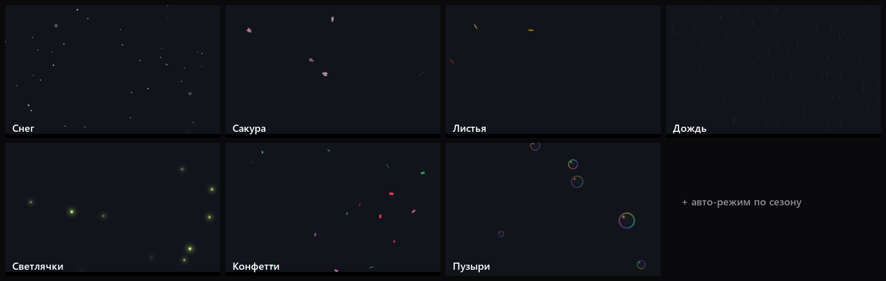
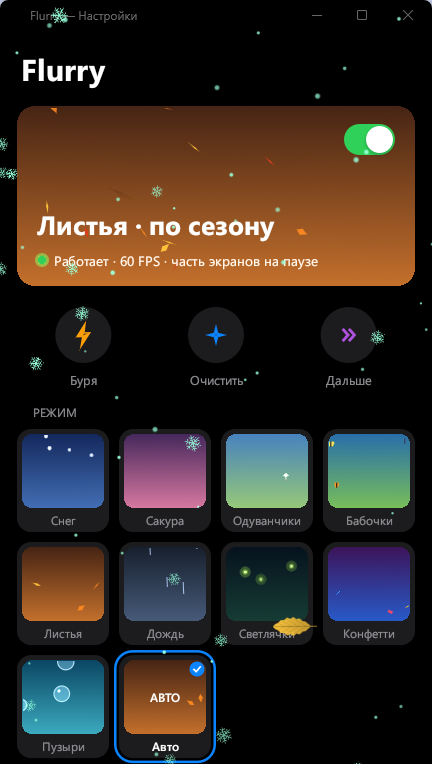
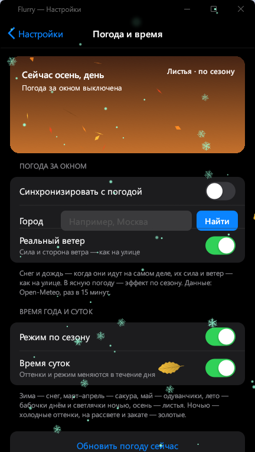
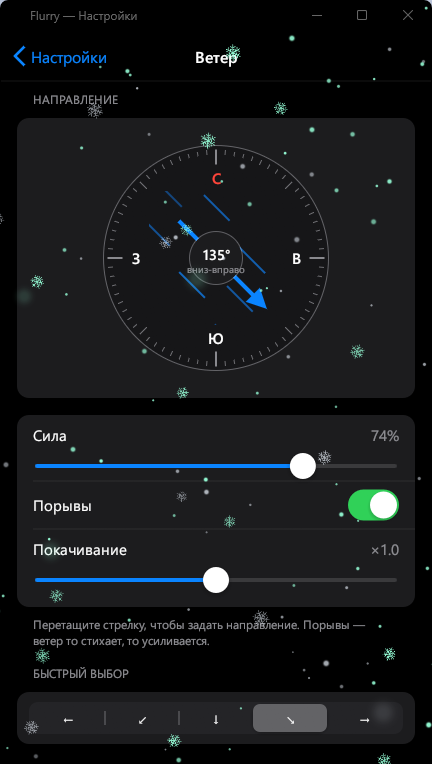
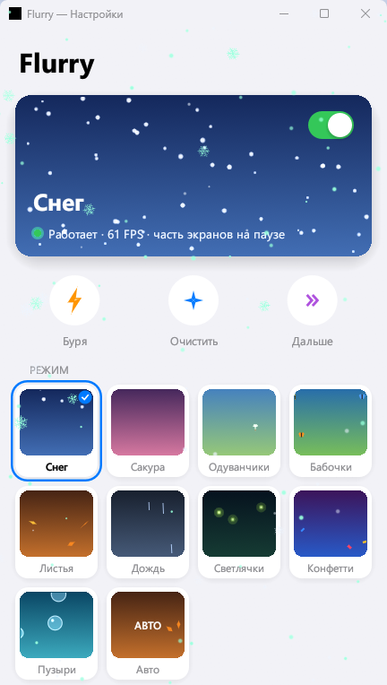

# Flurry

> **EN:** Live weather on top of your Windows desktop — snow, sakura, rain with fog and lightning, fireflies and more. Can mirror the real weather in your city. A single 4 MB portable exe, ~0.2% CPU, <10 MB RAM. Windows 10/11 x64. The UI is in Russian.

Живая погода прямо поверх рабочего стола Windows: снег, сакура, одуванчики, бабочки, листопад, дождь с туманом и грозой, светлячки, конфетти и мыльные пузыри. Может повторять **настоящую погоду в вашем городе**, время года и время суток. Частицы летят поверх всех окон, не мешают кликам и обходят курсор.

**Один exe-файл на 4 МБ без установки. В работе — около 0,2% процессора и меньше 10 МБ памяти.**



| Настройки | Погода и время | Ветер | Светлая тема |
|---|---|---|---|
|  |  |  |  |

## Возможности

- **9 режимов** с плавной сменой: снег (снежинки, объём, боке), сакура, одуванчики, бабочки, листья, дождь (туман, молнии, брызги о панель задач), светлячки, конфетти, пузыри (их можно лопать курсором).
- **Погода за окном.** Укажите город, и эффект повторит реальную погоду (данные [Open-Meteo](https://open-meteo.com), раз в 15 минут):
  - идёт снег — на экране снег, идёт дождь — дождь, при грозе — молнии;
  - сила осадков задаёт плотность частиц;
  - сила и сторона ветра — как на улице;
  - в ясную погоду включается эффект по сезону.
- **Время года и суток.** Зима — снег, март–апрель — сакура, май — одуванчики, лето — бабочки днём и светлячки ночью, осень — листья. Ночью оттенки холоднее, на рассвете и закате — золотые.
- **Ветер с направлением.** Его задают на компасе, сила регулируется от штиля до урагана. Есть порывы, покачивание и кнопка **«Буря!»**: 9 секунд сильного ветра.
- **Мышь** отталкивает или притягивает частицы, быстрое движение их сдувает. За курсором тянется шлейф из искр.
- **Оттенки:** «как есть», лёд, золото, роза, мята, радуга.
- **Окно настроек в стиле iOS.**
  - Страницы открываются и закрываются со сдвигом, назад можно вернуться свайпом от левого края.
  - Переключатели, слайдеры и сегменты анимированы.
  - Превью погоды в настройках живое.
  - Есть тёмная и светлая тема.
- **Мультимонитор и HiDPI** (Per-Monitor V2). Можно оставить эффект только на основном мониторе.
- **Пауза** в полноэкранных играх, видео и презентациях, а также при блокировке экрана. При паузе эффект не мешает играм.
- **Экономия:** FPS «Авто» (30–60, ровно сколько нужно для плавности) и 30 FPS при работе от батареи.
- **Горячие клавиши** настраиваются:
  - `Ctrl+Alt+S` — вкл/выкл;
  - `Ctrl+Alt+O` — настройки;
  - `Ctrl+Alt+M` — следующий режим.
  
  При нажатии появляется iOS-подсказка сверху экрана.
- **Трей:** левый клик открывает настройки, правый — меню, средний включает и выключает эффект.
- **Автозапуск** вместе с Windows (сразу в трей). Можно скрыть эффект от записи экрана и стримов.

## Требования

- Windows 10 (1903+) или Windows 11, x64.
- Видеокарта с Direct3D 10+ (если её нет, используется программный рендер WARP).
- Скрытие от записи экрана работает с Windows 10 2004; самый плавный темп кадров — на Windows 11 (`DCompositionWaitForCompositorClock`).

## Установка

1. Скачайте `Flurry.exe` со страницы [Releases](../../releases).
2. Положите файл в любую папку и запустите.

Откроются настройки, иконка (чёрный квадрат) появится в трее. Автозапуск включён по умолчанию, его можно отключить в «Основных».

> Exe не подписан, поэтому Windows SmartScreen может предупредить при первом запуске: «Подробнее» → «Выполнить в любом случае». Можно собрать exe самому, см. ниже.

## Командная строка

```
Flurry.exe                 запустить (или открыть настройки, если уже запущено)
Flurry.exe --tray          запустить без окна (так работает автозапуск)
Flurry.exe --settings      только окно настроек
Flurry.exe --toggle        вкл/выкл
Flurry.exe --mode rain     snow | sakura | dandelions | butterflies | leaves | rain | fireflies | confetti | bubbles
Flurry.exe --next-mode | --storm | --clear | --reload | --exit
Flurry.exe --settings --page weather   открыть сразу страницу (weather, particles, wind, mouse,
                                              effects, performance, hotkeys, general, about)
```

Настройки хранятся в `%APPDATA%\Flurry\settings.json`, там же `weather.json` (последняя погода) и `log.txt`.

## Конфиденциальность

Программа ничего не отправляет, пока вы не включите «Погоду за окном». Тогда раз в 15 минут название города (как вы его ввели) уходит в геокодер [Open-Meteo](https://open-meteo.com), а координаты — в их API погоды. Ни ключей, ни аккаунтов, ни телеметрии.

## Если что-то не так

- **Частицы не видны.** Проверьте статус на главной странице настроек: «Пауза · полноэкранное приложение» означает, что окно на переднем плане закрывает весь монитор. Отключить паузу можно в «Производительности».
- **Горячая клавиша не срабатывает.** Скорее всего, сочетание занято другой программой — задайте другое в «Горячих клавишах».
- **Ошибка видеокарты.** Обновите драйвер; подробности будут в `%APPDATA%\Flurry\log.txt`.
- **Удалить полностью.** Выключите автозапуск в «Основных» (или удалите значение `Flurry` из `HKCU\Software\Microsoft\Windows\CurrentVersion\Run`), закройте программу из трея и удалите exe и папку `%APPDATA%\Flurry`.

Для отладки: `HZ_PROFILE=1` раз в секунду пишет в лог время симуляции и рендера, `HZ_NO_CLOCK=1` отключает синхронизацию с композитором.

## Производительность

Замеры на Windows 11, 1920×1080 + 1440×900, видеокарта NVIDIA, процессор на 24 потока.

| | Прошлая версия (C#/.NET) | Rust-версия |
|---|---|---|
| Снег, процессор (весь ЦП) | 0,35–2,5% | **0,15–0,3%** |
| Дождь с туманом | ~0,8% и больше | **0,25–0,45%** |
| Память (рабочий набор) | 80–160 МБ | **7–10 МБ** |
| Размер exe | 169 МБ | **4 МБ** |
| Выключено / пауза | 0% | 0%, окна и видеокарта освобождены |

Почему такая разница:

- **Частицы рисует видеокарта.** Процессор только двигает частицы (≈0,02 мс на кадр) и отправляет видеокарте по 48 байт на частицу. Весь кадр — один вызов `DrawInstanced` на монитор. Форма снежинок, лепестков, листьев и пузырей рисуется процедурно в пиксельном шейдере, без текстур.
- **Вывод через DirectComposition.** Swapchain с premultiplied alpha, никаких `UpdateLayeredWindow` и копирования кадра через процессор.
- **Туман и вспышки молний** лежат в отдельном слое размером 1/8 экрана. Его растягивает композитор, обновляется он 15 раз в секунду.
- **Кадры синхронизированы** с тактом композитора (`DCompositionWaitForCompositorClock`), поэтому движение без рывков и поток не крутится вхолостую.
- **Окно настроек — отдельный процесс.** Когда его закрываете, его память освобождается полностью.

## Сборка из исходников

Нужны [Rust](https://rustup.rs) (stable, MSVC) и Visual Studio Build Tools с Windows SDK.

```powershell
cargo build --release
cargo test               # юнит-тесты (сезоны, погода, настройки, симуляция)
# или: .\tools\build.ps1   — соберёт в dist\ и перезапустит
```

Результат: `target\release\Flurry.exe`, статически слинкован, без зависимостей.

Чтобы выпустить релиз:

1. поднимите версию в `Cargo.toml`, `assets/app.rc` и `assets/app.manifest`;
2. добавьте раздел `# vX.Y.Z` в начало `CHANGELOG.md`;
3. запушьте тег `vX.Y.Z` — GitHub Actions прогонит тесты, соберёт exe, посчитает SHA-256 и создаст релиз с заметками из этого раздела CHANGELOG.

## Как устроено

```
src/
  main.rs          — аргументы командной строки: оверлей / окно настроек / команды
  app.rs           — основной процесс: трей, горячие клавиши (+ low-level hook как запасной путь), автозапуск, IPC
  osd.rs           — iOS-подсказка (layered-окно, анимация только прозрачностью и сдвигом)
  ipc.rs           — связь процессов (скрытое окно + WM_APP-сообщения)
  settings.rs      — настройки и их JSON
  auto.rs          — сезон, время суток, погода → итоговые настройки
  weather.rs       — Open-Meteo через системный WinHTTP
  render/
    mod.rs         — поток рендера: окна на каждый монитор, паузы, темп кадров, ветер, молнии
    sim.rs         — симуляция частиц
    gpu.rs         — Direct3D 11 + DirectComposition
    shader.hlsl    — все формы частиц
  ui/
    mod.rs         — окно настроек (egui): страницы, переходы, свайп назад
    widgets.rs     — iOS-виджеты, иконки, живые превью
```

## Участие

Баги и идеи — в [Issues](../../issues). Как собрать и что проверить перед pull request — в [CONTRIBUTING.md](CONTRIBUTING.md).

## Лицензия

[MIT](LICENSE) © 2026 p222222p222. При копировании и форках уведомление об авторстве нужно сохранить. Подпись автора встроена в exe (свойства файла, «О программе») и защищена проверкой целостности: изменённая сборка это покажет.
